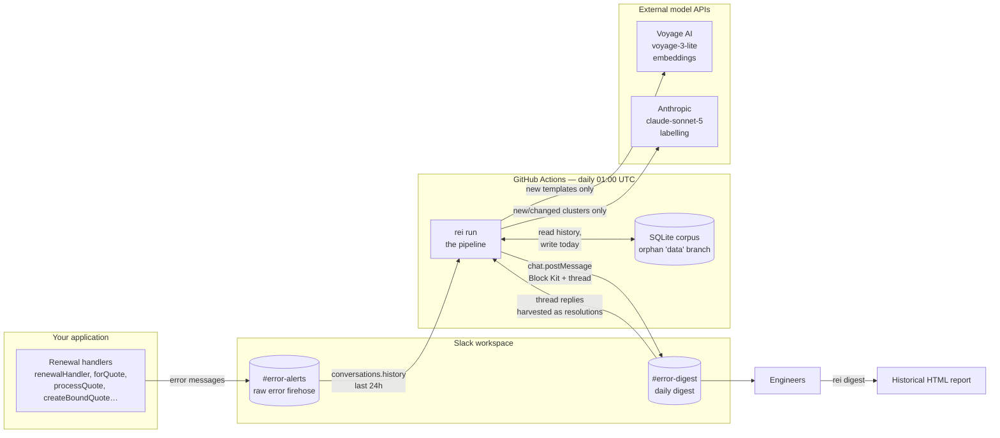
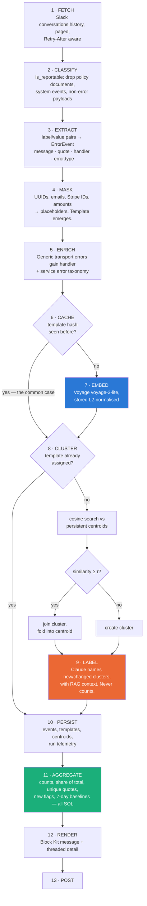
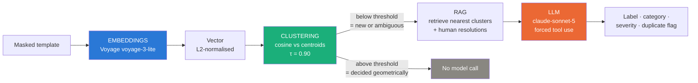
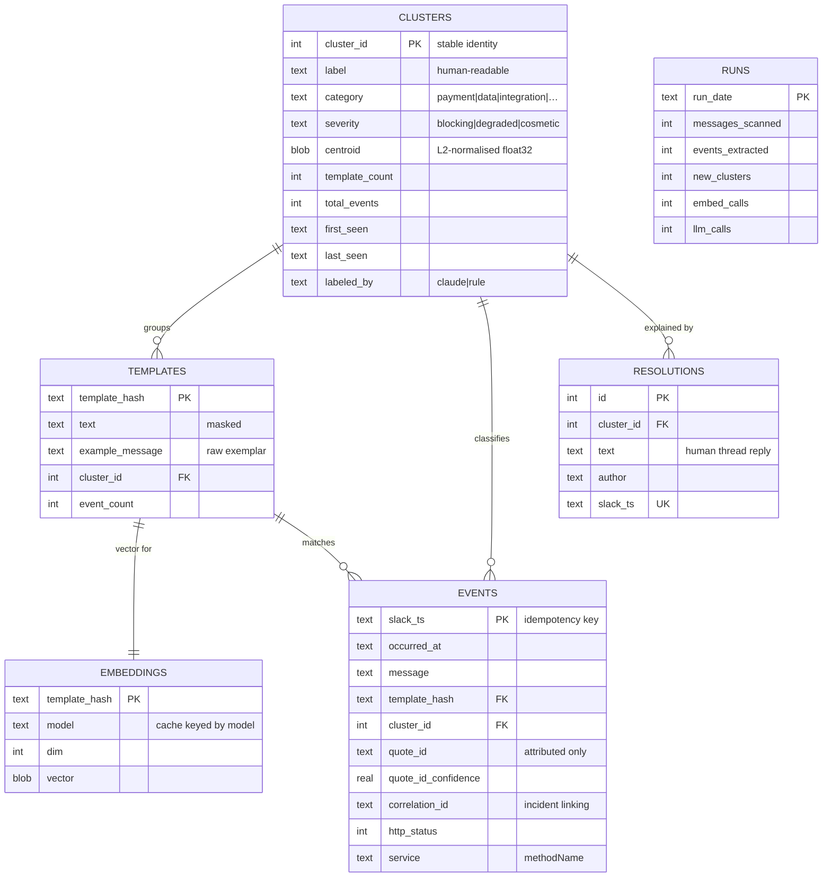
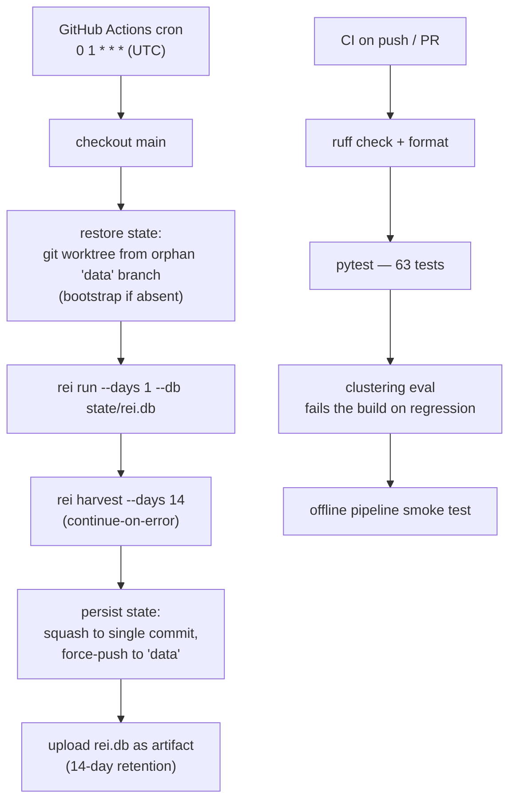

# Slack Error Intelligence — Design & Architecture

**Version 1.0 · August 2026**

A daily pipeline that reads the raw error firehose in Slack `#error-alerts`,
groups failures by what they actually are rather than by exact string match, and
posts a report engineers can act on to `#error-digest`.

---

## Contents

1. [Problem statement](#1-problem-statement)
2. [System context](#2-system-context)
3. [Technology stack](#3-technology-stack)
4. [Data flow](#4-data-flow)
5. [Component reference](#5-component-reference)
6. [The extraction layer](#6-the-extraction-layer)
7. [The AI layer](#7-the-ai-layer)
8. [Data model](#8-data-model)
9. [External APIs](#9-external-apis)
10. [Deployment](#10-deployment)
11. [Failure modes](#11-failure-modes)
12. [Cost model](#12-cost-model)
13. [Security & data handling](#13-security--data-handling)
14. [Evaluation](#14-evaluation)
15. [Operations runbook](#15-operations-runbook)
16. [Decision log](#16-decision-log)
17. [Deliberately not built](#17-deliberately-not-built)

---

## 1. Problem statement

### What existed

A 176-line Python script, run by hand from a laptop, with a Slack bot token
hardcoded on line 8. It fetched a day of messages, scraped any JSON value under a
key named `error` or `message`, grouped by exact string equality, and posted the
result.

### Why it failed

Measured against a seven-day export of a live production error channel:

| Symptom | Measured | Cause |
| --- | --- | --- |
| Most messages ignored | **20.3%** of messages parsed | The channel does not emit JSON. It emits Slack rich-text label/value blocks; the script's regex happened to match a minority. |
| Quotes wildly over-claimed | **1** quote correctly attributed out of 125 errors; 162 claimed | Every UUID anywhere in a payload was counted as an affected quote, including `correlationId`, `policyId` and `documentId`. |
| One failure split across many lines | e.g. `1 x Failed to get quote docs for: 8afd54b3-…` repeated | The quote ID sits inside the message text, so every occurrence hashed differently. |
| Unrelated failures merged | `12 x Request failed with status code 400` | Several upstreams emit that identical string. |
| Invented labels | `4 x Likely validation error \|\| response-validation` | A rule relabelled any combined message under 20 characters. |
| Counts and IDs disagreed | `4 x` with 30 quote IDs listed | The count was messages; the list was the union of all UUIDs. Two different measurements presented as one. |

### What this system delivers

- **100%** extraction coverage of candidate error messages
- **96.7%** of errors attributed to the correct quote, with the remainder
  reported honestly as unattributed rather than guessed
- Stable issue identities that survive across days, enabling *is this new* and
  *is this getting worse*
- Every issue reported with its **share of total errors**, not just a raw count —
  4,672 means nothing until you know it is 41% of everything
- A separation of engineering-owned defects from customer payment declines
- Correlation-ID linking that collapses one failure logged twice into one incident

### Non-goals

Not an alerting system (no paging, no thresholds-to-fire). Not a log store — Slack
remains the system of record. Not a replacement for APM; it reads what the service
already publishes.

---

## 2. System context



**The feedback loop matters.** When an engineer replies in-thread to a daily
report — *"this was the partner API certificate expiring, fixed"* — `rei harvest` pulls that
reply back into the corpus as a resolution note attached to the cluster. The
report channel becomes the RAG corpus at zero integration cost.

---

## 3. Technology stack

| Layer | Choice | Why | Rejected |
| --- | --- | --- | --- |
| Language | Python 3.11+ | Existing script was Python; the team reads it | — |
| HTTP | `httpx` | One client for all three providers, one retry policy | Three vendor SDKs — three retry philosophies, three version-drift surfaces |
| Validation | `pydantic` v2 + `pydantic-settings` | Typed domain model; env config with no secrets on disk | `dataclasses` + manual parsing |
| Numerics | `numpy` | Cosine search is one matmul | `scikit-learn` — a 30MB dependency for a dot product |
| CLI | `click` | Stable, ubiquitous | `typer` (a wrapper over click), `argparse` |
| Storage | SQLite (stdlib) | Zero infra, versioned in git, queryable with any client | Postgres/pgvector, Qdrant — both add a service to manage for a corpus of ~1k vectors |
| Embeddings | Voyage `voyage-3-lite` | Anthropic's recommended partner; pure HTTP, no weight in CI | `sentence-transformers` — 400MB torch download per CI run |
| Reasoning | Anthropic `claude-sonnet-5` | Labelling quality; forced tool use gives schema-validated output | OpenAI (second vendor), local models (weaker labels) |
| Scheduling | GitHub Actions cron | Free, secrets built in, no infra | AWS Lambda + EventBridge, Cloud Run Jobs |
| Testing | `pytest` (+ stdlib `unittest`) | 63 tests, none require network or secrets | — |
| Lint / types | `ruff`, `mypy` | Standard | — |

**Total runtime dependencies: five.** `httpx`, `pydantic`, `pydantic-settings`,
`numpy`, `click`. Everything else is the standard library.

---

## 4. Data flow



**The critical ordering property:** steps 1–10 mutate state, step 11 reads it
back. Every number in the report is computed *after* the model has already run
and been persisted. The LLM cannot influence a count even in principle.

### A steady-state day

~90 messages → ~60 errors → 15 templates → **0 embedding calls** (all cached),
**0 LLM calls** (no new clusters) → report posted. Runtime under 10 seconds,
cost zero.

---

## 5. Component reference

```
src/rei/
├── config.py       Environment-driven settings. No secrets on disk.
├── models.py       ErrorEvent, Cluster, ClusterReport, DailyReport
├── http.py         Shared retry / backoff / jitter / Retry-After for all providers
├── slack.py        Paged history, thread harvesting, posting
├── extract.py      Raw Slack message → structured ErrorEvent
├── masking.py      Volatile-token masking, generic-message detection
├── embeddings.py   Voyage client, content-hash cache, offline encoder
├── store.py        SQLite schema, migrations, vector search, DAO
├── clustering.py   Incremental assignment against persistent centroids
├── rag.py          Retrieval over historical clusters and human resolutions
├── llm.py          Claude labelling via forced tool use; rule-based fallback
├── pipeline.py     Orchestration. All counting happens here.
├── blocks.py       Block Kit rendering within Slack's limits
├── digest.py       Historical report: HTML + correlation-ID linking
├── baseline.py     The original algorithm, kept only for the eval
└── cli.py          click entry points
```

### Command surface

| Command | Reads from Slack | Frequency |
| --- | --- | --- |
| `rei backfill` | Everything the channel retains | **Once**, manual setup |
| `rei run --days 1` | **Last 24 hours only** | Daily, automatic |
| `rei harvest --days 14` | The *report* channel's thread replies | Daily, tiny |
| `rei digest` | Nothing — reads the local corpus | On demand |
| `rei dump-slack` | A window, to a JSON file | Development |
| `rei stats` | Nothing | On demand |
| `rei eval` / `rei tune-threshold` | Nothing | Development |

**History lives in SQLite, not in Slack.** The daily job fetches one day and asks
the local corpus whether it has seen each signature before. That is how `NEW`
badges and 7-day comparisons work without a single extra Slack call.

---

## 6. The extraction layer

The single largest source of the original script's failure. Worth its own section
because none of the AI matters if the input is 20% of reality.

### The real wire format

The renewal service posts Slack `rich_text` blocks as alternating label /
preformatted-value pairs, rendering as:

```
methodName    ```renewalHandler```
correlationId ```3f7a91c4-0b2e-4d88-9a17-5c6e2b7f4a90```
error         ```type: payment-failure
                 message: Renewal Flow: Card declined: Your card was declined.
                 error: {"type":"payment-failure","cause":{"type":"card-declined",…}}```
message       ```Renewal Flow for 1e7c3216-… : Renewal Flow: Card declined.```
```

### Three fields that changed everything

| Field | Used for | Why it matters |
| --- | --- | --- |
| `methodName` | Discriminating generic errors | `Request failed with status code 400` is emitted by six handlers. Without this they are indistinguishable. |
| `error.type` | Cluster **category**, directly | The service publishes its own taxonomy — `payment-failure`, `partner-api`, `not-found`. Authoritative; no model needed. |
| `correlationId` | **Excluded** from quote attribution; used for incident linking | It is a UUID that is *not* a quote. Counting it is most of the old 162-vs-125 discrepancy. |

### Parsing rules learned from real data

1. **Both views are parsed, richer wins.** When Slack truncates a long payload it
   drops the trailing preformatted element from `blocks` while the opening fence
   survives in `text`. Trusting `blocks` alone silently lost every partner-API
   validation failure — the messages with the most content.
2. **Sub-fields are not reliably newline-separated.** Some handlers emit
   `type: partner-api message: response-validation error: {…}` on one line. A
   line-anchored parser finds only `type` and drops the event.
3. **Truncated JSON still yields fields.** When the tail is cut mid-object,
   `"quoteId": "…"` and `"errorType": "…"` are recovered by regex.
4. **Quote IDs live in prose.** Matched by surrounding context —
   `for quote: <uuid>`, `Renewal Flow for <uuid>` — never by grabbing every UUID.
5. **The channel carries non-errors.** Policy wordings, endorsement clauses,
   quote-answer payloads, join events. Classified out so coverage measures
   something real.

### Attribution confidence

| Confidence | Basis |
| --- | --- |
| 1.0 | Named `quoteId` key |
| 0.8 | Matched by prose context |
| 0.5 | One candidate UUID after excluding `correlationId` |
| 0.0 | **Reported as unattributed** — never guessed |

### Masking

Volatile tokens become placeholders before matching: `<UUID>`, `<EMAIL>`,
`<STRIPE_ID>`, `<NUM>`, `<TS>`, `<URL>`, `<JWT>`, `<HEX>`.

**Numbers are handled asymmetrically on purpose.** Integers of one to three
digits survive, so `status code 400` and `status code 500` never merge. Decimals
and four-plus-digit integers are amounts or identifiers and are masked.

**Serialised exceptions are stripped**, promoting their inner `message` when the
surrounding prose is only a prefix. An `AxiosError` blob carries per-request
timeouts and URLs that differ every time; left in, it turned one CRM-sync failure
into eight singleton report lines.

---

## 7. The AI layer

Three distinct pieces with three distinct jobs. Keeping them separate is what
makes the system debuggable.



### 7.1 Embeddings

| | |
| --- | --- |
| Model | `voyage-3-lite` |
| Storage | L2-normalised `float32` BLOB in SQLite; dimensionality recorded per vector |
| Cache key | SHA-256 of the masked template, truncated to 32 chars |
| Batch size | 96 (24 under free-tier throttling) |

**The cache is why this runs daily for free.** A template is embedded once, ever.
After the initial backfill a normal day embeds only genuinely new templates —
typically zero to three.

**Free-tier handling.** Voyage accounts without a payment method are capped at 3
requests and 10,000 tokens per minute. The client detects that specific 429 body,
drops to 24-template batches paced at 3/min, and continues. A 900-template
backfill takes ~12 minutes instead of failing.

### 7.2 Clustering

Incremental assignment against persistent centroids.

```
1. Exact-template short circuit — a hash already assigned returns its cluster
   with no vector search. Handles almost everything on a steady day.
2. Otherwise: embed, cosine-search the centroid matrix.
3. similarity ≥ τ  → join; fold vector into the centroid as a count-weighted
                     running mean; re-normalise.
4. similarity < τ  → open a new cluster seeded at this vector.
```

**Why incremental rather than k-means or HDBSCAN.** Cluster identity must survive
across days. If today's cluster 3 is not yesterday's cluster 3, then *is this
new*, *is this getting worse*, and the resolution corpus are all meaningless.
Batch clustering gives better cluster shape on a frozen corpus and no continuity
at all. Continuity wins.

**Determinism.** Templates are processed in descending frequency order, so the
day's dominant template seeds a cluster before its rarer variants arrive. Same
input → same output, which is what makes the eval and the tests meaningful.

**Two thresholds, because two encoders.**

| Encoder | τ | Basis |
| --- | --- | --- |
| `voyage-3-lite` | **0.90** | Measured on six months of real traffic. At 0.76 it merged *Failed to update quote* with *Parent quote found as cancelled*; at 0.86 it still merged four distinct Stripe decline reasons. |
| Offline hashed n-gram | **0.76** | Midpoint of the measured `[0.70, 0.82]` plateau where the labelled fixture set scores V-measure 1.000. |

The pipeline selects the threshold matching the encoder *actually in use* —
falling back to the offline encoder without also falling back to its threshold
would silently wreck the clustering.

Re-tune with `rei tune-threshold --online`. Pick the middle of the widest
plateau, not the single best point; a threshold on a cliff edge will not survive
new wording.

### 7.3 The LLM

**Scope discipline, stated plainly because it is the part worth defending:**

> The model names and categorises clusters. **It never counts anything.**
> Frequencies, unique-quote tallies and new-vs-recurring are computed in SQL from
> the events table, after clustering has settled.

A model asked to both interpret and tally will quietly get the tallies wrong, and
a report whose numbers cannot be trusted is worse than no report.

**When it runs.** Only for clusters whose membership changed — created now, or
joined by a new template. A steady day makes zero calls.

**Relabelling on membership change** matters: a cluster seeded by *"card has
insufficient funds"* kept that name after expired-card and
transaction-not-allowed declines joined it, so the report named one specific
cause while counting five. On relabel the model sees all current members.

**Structured output via forced tool use**, not "reply in JSON" — the response is
schema-validated at the API boundary rather than by a regex on our side.

```jsonc
{
  "tools": [{ "name": "record_labels", "input_schema": { /* … */ } }],
  "tool_choice": { "type": "tool", "name": "record_labels" }
}
```

Returned per cluster: `label`, `category` (enum), `severity` (enum),
`duplicate_of` (recorded and logged, **never auto-applied**), and optionally
`root_cause` + `suggested_action` behind `REI_ENABLE_DIAGNOSIS`.

**Schema validation guarantees shape, not sanity.** Given a single input cluster
the model has been observed returning 149 and 156 entries, one of them a bare
string. Defences: `maxItems` on the array; the expected count and index values
stated explicitly in the prompt; and a merge step that discards anything which is
not a dict with an in-range integer index, guaranteeing exactly one label per
cluster.

**Service metadata beats inference.** `error.type` and `error.cause.type` are
passed through as hints and map directly onto categories. The model is told they
are authoritative.

### 7.4 RAG

**Corpus** — self-bootstrapping, no external integration:

- every cluster ever created, with its masked templates
- exemplar raw messages per cluster
- **human resolutions** harvested from thread replies on past reports

**Retrieval fires at exactly one decision point:** when a template failed to match
any cluster above threshold. That is precisely where a purely geometric decision
is least reliable — *is this the same failure worded differently, or genuinely
new?* Everything above threshold is decided by cosine distance with no model in
the loop, which keeps cost near zero and behaviour predictable.

**Injected context:** the near-miss clusters with similarity scores, their
exemplars, their all-time event counts, and any recorded resolutions. A cluster
is never shown as a neighbour of itself.

### 7.5 Correlation-ID incident linking

Not AI — pure SQL and set arithmetic — but it answers a question the clustering
cannot.

One failure often emits several log lines: a duplicate-email lookup fails, then
account creation fails as a consequence. Each becomes its own cluster. Counted
separately they inflate the issue list and hide that fixing one removes both.

The `correlationId` the service already stamps on every message is the join.

```
containment = shared_correlation_ids / min(|A|, |B|)
link if containment ≥ 0.6 and shared ≥ 5
direction from the timestamps within each shared trace
```

**Containment, not Jaccard.** The question is not "are these the same size" but
"does one essentially always come with the other". A 477-event cluster fully
inside a 4,000-event cluster is still one incident with two log lines; Jaccard
scores that near 0.1 and misses it.

Linked groups are collapsed by union-find, so a chain A→B→C counts once.

---

## 8. Data model



### Invariants

| Invariant | Enforced by |
| --- | --- |
| Re-running a window is idempotent | `events.slack_ts` primary key |
| Cumulative counters advance only for genuinely new events | `existing_event_ids()` checked before incrementing |
| Cluster IDs never move once a template is assigned | Exact-template short circuit |
| Two clusters never share a label | Uniqueness check in `set_cluster_label` |
| `centroid` is always unit length | Re-normalised after every fold |

Overlapping windows are normal — a manual `--days 3`, a retried job. Without the
counter guard, historical baselines drift upward with no failure ever occurring.

### Migrations

Additive and automatic. An existing corpus represents hours of backfill and is
never rebuilt to pick up a column; `Store._migrate()` runs `ALTER TABLE` on open
for anything missing.

### Vector search

Exact cosine over the centroid matrix — one `numpy` matmul, sub-millisecond at a
few thousand centroids, and *more* correct than an approximate index. A
`sqlite-vec` virtual table earns its place somewhere north of 10⁵ vectors; the
search is isolated behind `Store.search_clusters` so the swap is a one-function
change.

---

## 9. External APIs

All three are JSON over HTTPS and fail the same three ways — transient 5xx,
connection reset, 429 with `Retry-After`. `src/rei/http.py` gives them one retry,
backoff, jitter and rate-limit policy, written once and tested once.

### 9.1 Slack Web API

| Method | Use | Scope |
| --- | --- | --- |
| `conversations.history` | Read `#error-alerts` | `channels:history` / `groups:history` |
| `conversations.replies` | Harvest resolutions | same |
| `chat.postMessage` | Post report + thread | `chat:write` |
| `auth.revoke` | Rotate a compromised token | — |

**Rate limits.** Since May 2025, `conversations.history` is capped at **1 request
per minute and 15 objects per page** for non-Marketplace *distributed* apps.
Internal apps built inside your own workspace — which this is — keep Tier 3 and
1,000 objects per page. The client assumes neither: it requests a large page,
observes what comes back, and paces accordingly, so a full backfill completes
under either regime.

**Block Kit limits enforced at render:** 50 blocks per message, 3,000 chars per
section, 150 per header, 10 elements per context block. Quote IDs move to a
threaded reply so the channel view stays scannable.

### 9.2 Voyage AI

```
POST https://api.voyageai.com/v1/embeddings
Authorization: Bearer $REI_VOYAGE_API_KEY
{ "input": [...], "model": "voyage-3-lite", "input_type": "document", "truncation": true }
```

Responses are sorted by `index` before use; a count mismatch raises rather than
silently misaligning vectors to templates.

### 9.3 Anthropic

```
POST https://api.anthropic.com/v1/messages
x-api-key: $REI_ANTHROPIC_API_KEY
anthropic-version: 2023-06-01
{ "model": "claude-sonnet-5", "max_tokens": 4096, "system": "...",
  "tools": [...], "tool_choice": { "type": "tool", "name": "record_labels" } }
```

Any failure is caught and degrades to rule-based labels. Losing the day's report
because a label could not be generated would be the wrong trade.

---

## 10. Deployment



### Configuration

| Secret | Purpose |
| --- | --- |
| `REI_SLACK_BOT_TOKEN` | Read source channel, post report |
| `REI_ANTHROPIC_API_KEY` | Cluster labelling |
| `REI_VOYAGE_API_KEY` | Embeddings |

| Variable | Purpose |
| --- | --- |
| `REI_SOURCE_CHANNEL_ID` | `#error-alerts` |
| `REI_DEST_CHANNEL_ID` | `#error-digest` |
| `REI_MENTION_USER_IDS` | JSON list of user IDs to @-mention |

Locally the same names come from a git-ignored `.env`.

### Why the `data` branch is force-pushed as one commit

The SQLite file is a binary blob that changes every day. Keeping its git history
would grow the repo without bound. The history that matters — every event,
template, cluster and resolution — lives inside the database's own tables.

### CI as a quality gate, not a report

The eval runs on the offline encoder, so it needs no secrets and no network. If a
change drops clustering homogeneity below 0.99, completeness below 0.95, or makes
the pipeline no better than the baseline it replaces, **the build fails**.

---

## 11. Failure modes

| What breaks | Behaviour |
| --- | --- |
| Voyage key missing / API down | Falls back to the local hashed encoder *and* its threshold; clustering degrades to lexical, run completes |
| Voyage free-tier 429 | Detected from the response body; throttles to 3 req/min in small batches and continues |
| Anthropic key missing / API down | Rule-based labels; counts unaffected |
| Model returns malformed labels | Discarded with a warning; exactly one label per cluster guaranteed |
| Slack 429 | `Retry-After` honoured; page-size drop detected and pacing adapted |
| Slack outage | Run fails, no state written; the next run's wider window catches up |
| `data` branch missing | Workflow bootstraps an orphan branch |
| Same window run twice | Idempotent — no duplicate events, no new clusters, no counter inflation |
| Backfill interrupted mid-way | Chunks are committed as they complete; re-running resumes |
| Report exceeds Block Kit limits | Truncated at 50 blocks with an explicit "N omitted" line; full detail in thread |
| Old database, new schema | Additive migration on open; rows preserved |

**Design principle: degrade, never fail.** Every model dependency has a
deterministic fallback. The pipeline always produces a report.

---

## 12. Cost model

| | Per run | Per year |
| --- | --- | --- |
| Voyage embeddings | ~0 (cache hit) to $0.0001 | < $0.05 |
| Claude labelling | $0 on a quiet day, ~$0.002 with new clusters | < $1 |
| GitHub Actions | free tier | $0 |
| Storage | SQLite in a git branch | $0 |

The initial backfill is the only meaningful spend and it is cents. Steady-state
marginal cost is genuinely zero on most days, because the caches hit.

---

## 13. Security & data handling

**Secrets.** Never on disk, never in code. `pydantic.SecretStr` throughout;
`.env` is git-ignored; CI uses repository secrets. *The script this replaced had
a live `xoxb-` token on line 8 — rotation, not deletion, is the fix for that,
since it persists in git history.*

**Customer data.** Payloads contain emails, Stripe customer IDs and business
names. Handling:

- Masking replaces them with placeholders in every template and label
- `events.raw_excerpt` retains the original, so treat `rei.db` as containing
  customer data and keep the `data` branch in a **private** repo
- Raw Slack dumps (`fixtures/slack_dump*.json`) are git-ignored
- `scripts/inspect_payloads.py` passes everything through the masking layer
  before printing, so diagnostics can be shared in a ticket or chat safely

**Least privilege.** The bot needs read on one channel, write on another.

---

## 14. Evaluation

`make eval` scores the pipeline against a faithful port of the original script on
196 labelled messages — 156 errors across 12 known failure types, plus 40
endorsement documents that must be filtered rather than counted. Fixtures are
generated in the **real wire format**, and every failure shape in them was
observed in an actual export.

Each row adds one stage, so the gain is attributable rather than hand-waved at
"we added AI":

```
variant                       homog. complet.       V     ARI   #pred   #true
------------------------------------------------------------------------------
1 baseline (exact string)      0.903    0.897   0.900   0.880      22      12
2  + token masking             0.903    0.966   0.934   0.891      11      12
3  + context enrichment        1.000    0.970   0.985   0.979      13      12
4  + lexical vectors           1.000    1.000   1.000   1.000      12      12

quote attribution            precision  recall      F1   claimed  correct
------------------------------------------------------------------------
1 baseline (exact string)        0.500   1.000   0.667       312      156
2  + token masking               1.000   1.000   1.000       156      156
```

**Most of the gain involves no model at all.** Masking and enrichment do the
heavy lifting; vectors close the last gap by merging two timeout wordings. Being
able to say which stage earned what is the point of running the ablation.

**Metrics:** homogeneity (are unrelated failures merged?), completeness (is one
failure split across lines?), V-measure, adjusted Rand index. Implemented
dependency-free in `evals/metrics.py` and property-checked against scikit-learn
across 25 randomised trials in the test suite.

**Threshold selection** is a sweep, not a guess — a plateau is identified and the
midpoint taken.

### Measured on real traffic

Figures below come from a seven-day export of a live production error channel
(~11.4k error events). The channel and its operator are not named here; the
committed fixtures are synthetic reproductions of the same message pathologies,
so every number in the eval section is reproducible by anyone who clones this
repository.

| | Before | After |
| --- | --- | --- |
| Extraction coverage | 20.3% | **100%** |
| Quotes attributed | 1 of 125 | **412 of 426 (96.7%)** |
| Generic errors with no discriminator | 40 | **0** |
| Templates from 426 errors | — | 23 |

---

## 15. Operations runbook

```bash
# What is in the corpus
rei stats

# Re-render a wider window without posting
rei run --days 3 --dry-run

# Historical report
rei digest --days 180 --out report.html

# Re-sweep the threshold after changing encoder
rei tune-threshold --online

# Diagnose extraction against a fresh export (output is masked, safe to share)
rei dump-slack --days 7
python scripts/inspect_payloads.py fixtures/slack_dump.json
```

**Changing the threshold does not retroactively re-cluster.** To rebuild the
taxonomy: delete the database and re-run `rei backfill`. Events are re-derived
from Slack, so nothing is lost but human resolutions — export the `resolutions`
table first if any exist.

**Backfill sizing.** Full history is ~90,000 messages / ~67,000 errors and makes
a large database that is force-pushed daily. 180 days is far more baseline than
the 7-day comparison needs.

---

## 16. Decision log

| # | Decision | Rationale | Rejected alternative |
| --- | --- | --- | --- |
| 1 | Incremental clustering | Cluster identity must survive across days | k-means / HDBSCAN — better shape, zero continuity |
| 2 | Exact vector search | Sub-millisecond and exact at this scale | ANN index — a dependency, a build step and approximation error to save nothing |
| 3 | SQLite in a git branch | Zero infra, versioned, queryable | Postgres/pgvector, Qdrant — a service to manage for ~1k vectors |
| 4 | Raw HTTP, not SDKs | One retry policy for three providers; five total deps | Three vendor SDKs |
| 5 | LLM labels, never counts | Models interpret well and tally badly | One prompt producing both |
| 6 | Forced tool use | Schema-validated at the API boundary | "Reply in JSON" + regex parsing |
| 7 | RAG only at the decision boundary | Cost near zero; predictable behaviour | Retrieval on every cluster |
| 8 | Two clustering thresholds | Different encoders, different similarity distributions | One number serving both — silently wrecks clustering on fallback |
| 9 | `duplicate_of` recorded, not applied | Automatic merges are hard to unpick once history depends on IDs | Auto-merge on the model's say-so |
| 10 | Service `error.type` over inference | The emitting code knows better than a classifier | Model-derived categories only |
| 11 | Unattributed quotes reported honestly | A wrong quote ID is worse than a missing one | Guessing from the first UUID |
| 12 | Containment over Jaccard for linking | Asymmetric sizes are the normal case | Jaccard — misses every real pair |
| 13 | Degrade, never fail | A rule-labelled report beats no report | Fail fast on model errors |

---

## 17. Deliberately not built

| Item | Status |
| --- | --- |
| Auto-merge on `duplicate_of` | Recorded and logged; a human should approve |
| Statistical anomaly detection | `prior_daily_mean` and `NEW` badges exist; the proper spike test does not |
| Root cause + suggested fix | Implemented behind `REI_ENABLE_DIAGNOSIS`, off by default until label quality has been reviewed for a fortnight |
| Codebase-aware RAG | Would let the report name the likely file; needs repo access |
| Jira / Linear linking | Would close the loop from error to ticket to fix |
| Alerting / paging | This is a daily digest, not a monitor |
| `sqlite-vec` | Worth adding north of 10⁵ vectors |

---

## Appendix — glossary

| Term | Meaning |
| --- | --- |
| **Event** | One error occurrence extracted from one Slack message |
| **Template** | A masked error string; the unit that gets embedded |
| **Cluster** | A persistent semantic group of templates, with a stable ID |
| **Centroid** | The unit-length mean vector of a cluster's templates |
| **τ (tau)** | Cosine similarity threshold for joining a cluster |
| **Containment** | `shared / min(|A|, |B|)` — asymmetric overlap measure |
| **Homogeneity** | Does each predicted cluster contain only one true failure? |
| **Completeness** | Is each true failure kept in one predicted cluster? |
| **Correlation ID** | The trace ID the renewal service stamps on every message |
